# DocuSense

**Turn a photo of a receipt or invoice into validated, structured data — with two deep-learning models trained from scratch.**

DocuSense reads a receipt or invoice (photo, scan or PDF) and returns the **vendor, date, subtotal, tax, total, invoice number and line items**, checks that the arithmetic adds up, flags anything uncertain for a human, and lets you correct and export the result (JSON, CSV, Excel).

* **No pretrained weights, no LLM or external AI API.** Both neural networks were designed, trained and evaluated from scratch on Kaggle's free GPU.
* **No Transformer.** The tagger is a CNN + bidirectional LSTM, chosen so that every component can be explained.
* **One external component:** the Tesseract OCR engine, isolated in a single file ([`pipeline/ocr.py`](pipeline/ocr.py)).

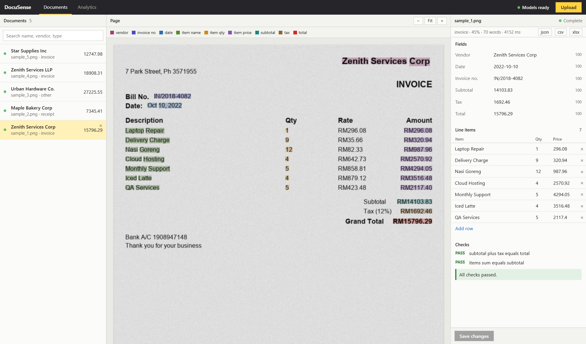

---

## Contents

[Why this project](#why-this-project) · [How it works](#how-it-works) · [The two models](#the-two-models) · [Datasets](#datasets) · [Results](#results) · [Quick start](#quick-start) · [API](#api) · [Training](#training-on-kaggle) · [Project structure](#project-structure) · [Testing](#testing) · [Documentation](#documentation) · [Limitations](#limitations) · [Credits](#credits-and-licences)

---

## Why this project

OCR turns an image into text, but **it does not understand it**. It cannot tell the vendor from the address, or the total from the cash tendered. Hand-written rules ("the total is the number next to the word TOTAL") break as soon as the layout, wording or number format changes.

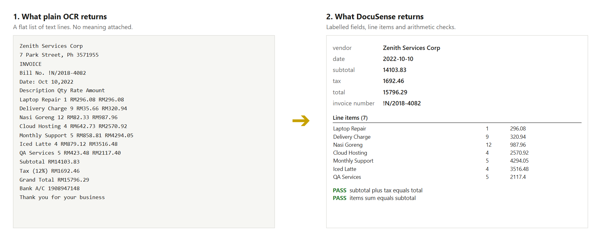

On the same held-out receipts, using the datasets' own correct words (so OCR errors cannot be blamed), a rule-based extractor reaches a token macro-F1 of **0.267**. The learned tagger reaches **0.970**. Subtotal accuracy goes from 3 % to 98.5 %.

---

## How it works

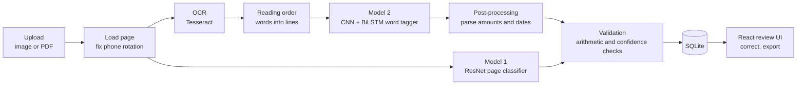

1. **Model 1** looks at the whole page and says what kind it is: `RECEIPT`, `INVOICE`, `FORM`, `LETTER` or `OTHER`.
2. **Tesseract** reads the words and their positions.
3. **Model 2** gives every word one of 10 labels (`VENDOR`, `DATE`, `ITEM_NAME`, `ITEM_QTY`, `ITEM_PRICE`, `SUBTOTAL`, `TAX`, `TOTAL`, `INVOICE_NO`, `OTHER`).
4. **Rules** turn labelled words into fields (parsing `1.234,50`, `10-Oct-22`, wrapped item names).
5. **Validation** checks that *subtotal + tax = total*, that items sum to the subtotal, that required fields exist, that confidences are high, and — using Model 1 — that the page is really a receipt or invoice. Anything doubtful becomes **NEEDS REVIEW**.

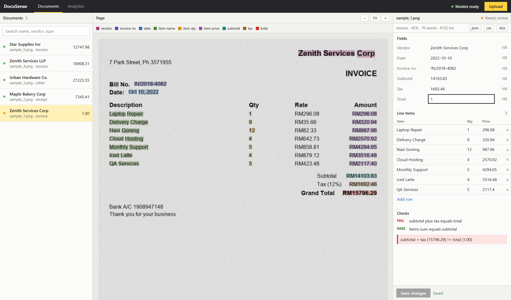

---

## The two models

### Model 1 — page classifier (ResNet, 3.32 M parameters)

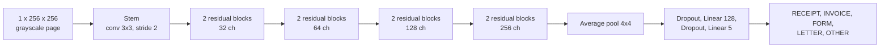

Eight residual blocks with batch normalisation and zero-initialised block outputs, AdamW with a OneCycle schedule, label smoothing and class weights, mixed precision. Page layout is kept by pooling to 4×4 instead of 1×1.

### Model 2 — word tagger (three-branch CNN + BiLSTM, 1.79 M parameters)

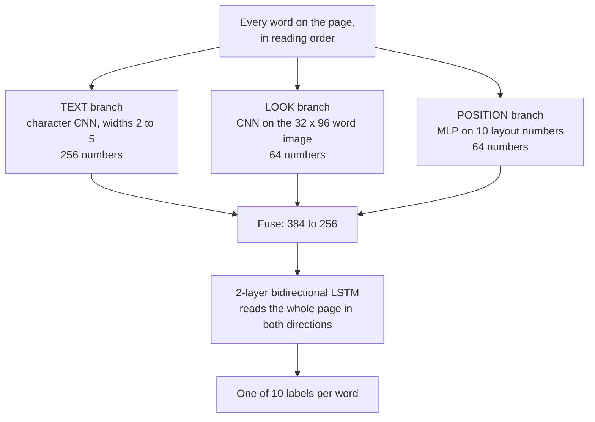

* **Text** — what the word says (handles `RM16.43`, codes, OCR typos).
* **Look** — what it looks like (totals are often bold and large).
* **Position** — where it is on the page (vendors on top, totals low and right).
* **BiLSTM** — context from the neighbours: a number after `TOTAL` is a total.

**Partial-label loss.** CORD has no vendor or date labels, SROIE has no item labels. Training naively on both would teach the model that a vendor is `OTHER` *and* `VENDOR`. For a word labelled `OTHER` in a source that does not annotate class *C*, the loss accepts either: `−log( p(OTHER) + p(C) )`. See [`models/tagger/loss.py`](models/tagger/loss.py).

---

## Datasets

| Dataset | Used for | What it is | Size used |
|---|---|---|---|
| **CORD-v2** | Model 2 | Indonesian shop and restaurant receipts with word-level labels for items, subtotal, tax, total | 800 / 100 / 100 receipts |
| **SROIE 2019** | Model 2, Model 1 (receipts) | Malaysian receipts; only company, date, address and total as text — we locate them to create word labels | 570 / 52 / 343 receipts (99.2 % of 973 kept) |
| **Synthetic invoices** | Model 2 | Pages drawn by [`data/synth_invoices.py`](data/synth_invoices.py): perfect labels, adds invoice numbers and table layouts | 2,000 / 200 pages, at most 30 % of training |
| **RVL-CDIP** | Model 1 | 400,000 scanned office pages in 16 classes, streamed with a per-class cap | 3,000 each of invoice, form, letter, other |

Validation and test sets contain **real data only**. Classes of RVL-CDIP are mapped **by name, not by number**, because copies of the dataset number them differently.

---

## Results

Measured on held-out test data (Kaggle T4 training: about 19 min for Model 1, 31 min for Model 2).

| | Result |
|---|---|
| **Model 1** — 5-class page accuracy | **89.5 %** (target was 93 %, not reached). Recall: receipt 98.9, invoice 84.6, form 87.6, letter 88.6, other 88.8 |
| **Model 2** — token macro-F1 (CORD + SROIE test) | **0.970** (rule-based baseline 0.267) |
| **Model 2** — field accuracy | date 100 % · subtotal 98.5 % · tax 97.6 % · vendor 95.3 % · total 94.1 % |
| **Live pipeline**, real Tesseract, 20 unseen synthetic invoices | vendor, subtotal, total, date 20/20 · tax 19/20 · invoice number 11/20 |

<p>
  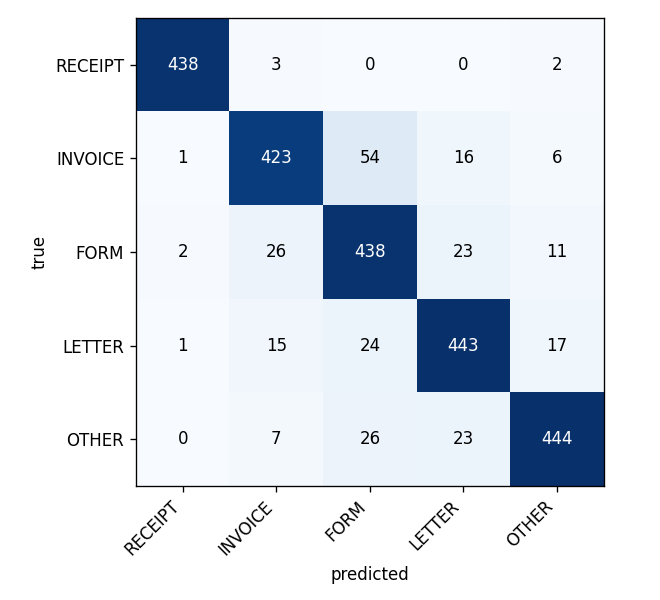
  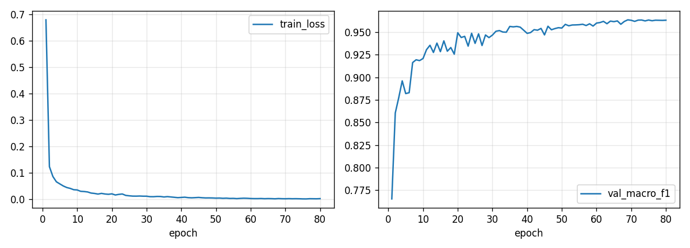
</p>

**Read these honestly.** The 0.970 uses the datasets' own words (perfect OCR). The live check used synthetic pages. Accuracy on real, messy phone photos has not been measured at scale and will be lower — see [Limitations](#limitations). The ablation notebook that measures each branch's contribution is prepared but has not been run.

---

## Quick start

**You need:** Python 3.10–3.12, Node 18+, [Tesseract OCR](https://github.com/UB-Mannheim/tesseract/wiki), and the two trained files `models/checkpoints/classifier_v1.pth` and `tagger_v1.pth` (they are git-ignored; produced by the Kaggle notebooks).

```powershell
# one-time setup
python -m venv .venv
.venv\Scripts\Activate.ps1
pip install torch==2.3.1 --index-url https://download.pytorch.org/whl/cpu
pip install -r requirements.txt
cd frontend ; npm install ; cd ..

# terminal 1 - backend
uvicorn api.main:app --port 8000

# terminal 2 - frontend
cd frontend
npm run dev                      # open http://localhost:5173
```

Port 8000 busy (Docker/WSL)? Run the backend with `--port 8010` and start the frontend with `$env:VITE_API_URL="http://127.0.0.1:8010"`.
Tesseract not on PATH? Copy [`.env.example`](.env.example) to `.env` and set `DOCUSENSE_TESSERACT_CMD`.

Command line only: `python -m pipeline.run samples/sample_1.png`

Five sample invoices are in [`samples/`](samples/). A full step-by-step demo script is in [`PROJECT_REPORT.md`](PROJECT_REPORT.md#19-demo-run).

### What happens on an upload

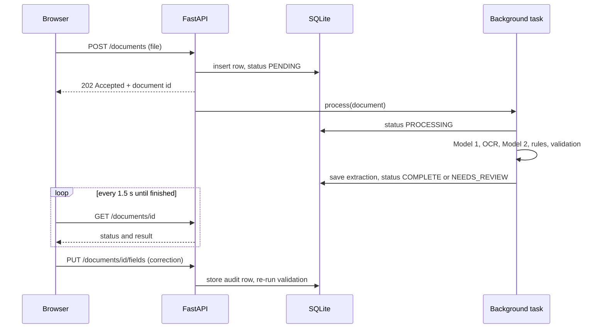

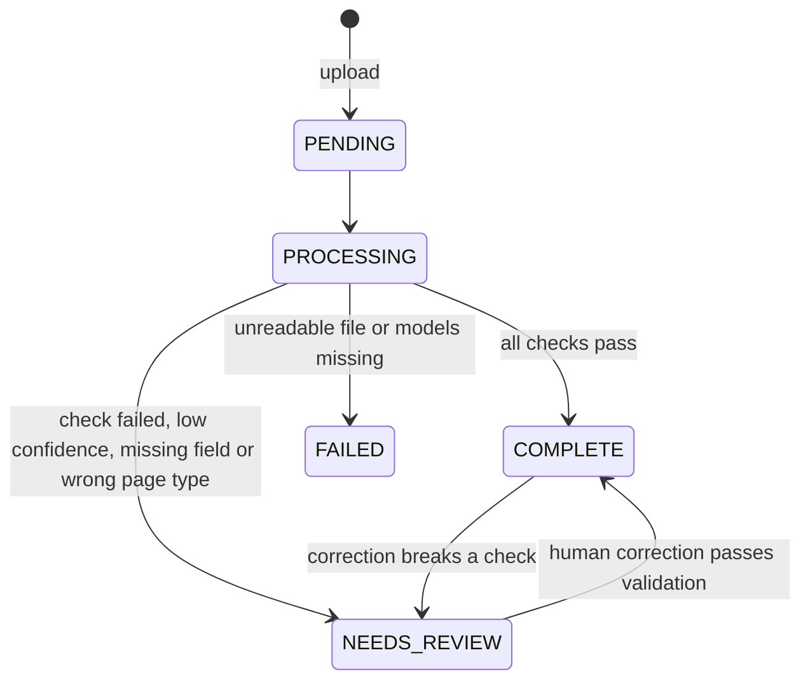

---

## API

| Method and path | Purpose |
|---|---|
| `POST /documents` | Upload a file (202). 415 unsupported type, 413 over 20 MB, 400 empty |
| `GET /documents` | List documents |
| `GET /documents/{id}` | One document with its full result |
| `GET /documents/{id}/image` | The stored page image |
| `PUT /documents/{id}/fields` | Save corrections and re-validate (422 for an unknown field) |
| `GET /documents/{id}/export?fmt=json\|csv\|xlsx` | Download the result |
| `DELETE /documents/{id}` | Delete a document |
| `GET /analytics/summary` | Volume, review rate, correction rate, speed, confidence per field |
| `GET /health` | Service status and any missing model files |

Interactive docs: `http://127.0.0.1:8000/docs`.

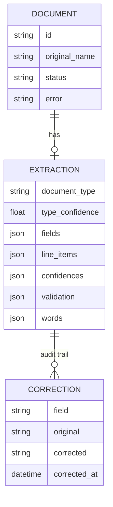

---

## Training on Kaggle

Nothing is trained on the development PC. Four notebooks in [`notebooks/`](notebooks/) run on Kaggle's free tier; the full guide is in [`KAGGLE_TRAINING.md`](KAGGLE_TRAINING.md).

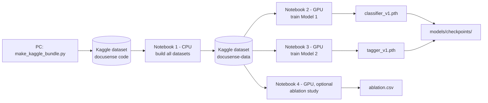

Every training run starts with a sanity check (memorise a handful of examples), saves a checkpoint each epoch (a dead session resumes), fixes all seeds, and keeps the best-validation weights.

---

## Project structure

```
api/              FastAPI app: routers (documents, analytics), background task, schemas
config/           settings (DOCUSENSE_* environment variables)
db/               SQLAlchemy models: documents, extractions, corrections
models/
  classifier/     Model 1: architecture, dataset, train, evaluate, predict
  tagger/         Model 2: architecture, loss, dataset, train, evaluate, predict, postprocess, baseline
  checkpoints/    trained .pth files (git-ignored)
data/             dataset builders (CORD, SROIE, RVL-CDIP, synthetic), reading order, word crops
pipeline/         preprocess, OCR, model loader, end-to-end run
validation/       arithmetic and confidence rules
frontend/         React + TypeScript + Vite review interface
notebooks/        the four Kaggle notebooks
evaluation/       script to measure accuracy on your own documents
samples/          five sample invoices
tests/            40 automated tests
tools/            Kaggle bundle builder, notebook converter
```

---

## Testing

```powershell
pytest -q                                                         # 40 tests, about 1-2 minutes
python -m evaluation.run_evaluation evaluation/own_eval.samples.json   # accuracy on the sample invoices
```

Tests cover amount and date parsing, reading order, dataset builders, model shapes and padding, train/serve feature parity, a tiny CPU training run, the API, the pipeline and the validation rules. The web interface was also driven end to end in a real browser (upload, highlighting, editing, exports, analytics, error cases).

**Testing the whole project as a tester?** Follow [`TESTING.md`](TESTING.md): setup, sample files, 26 manual checks with expected results.

---

## Documentation

| File | What it is |
|---|---|
| [`PROJECT_REPORT.md`](PROJECT_REPORT.md) | The detailed report: problem, datasets, both models layer by layer and why, training, results, design Q&A, demo run |
| [`TESTING.md`](TESTING.md) | Step-by-step tester guide |
| [`KAGGLE_TRAINING.md`](KAGGLE_TRAINING.md) | How to rebuild the data and retrain both models on Kaggle |
| [`PPT.md`](PPT.md) | Slide-by-slide plan for the presentation |

---

## Limitations

* **OCR dependence:** Tesseract errors flow into the result (invoice numbers are the weakest field).
* **Real-world accuracy not yet measured at scale:** use [`evaluation/run_evaluation.py`](evaluation/run_evaluation.py) on your own documents.
* **Training data bias:** Indonesian and Malaysian printed receipts plus clean synthetic invoices; handwriting, other languages and unusual layouts are weaker.
* **Page classifier at 89.5 %:** invoices are often confused with forms, so it only *warns*, never blocks.
* **First page only** for PDFs. Single user, no login, by design.

**Ideas for next steps:** run the ablation, add real labelled invoices (the stored corrections are ready-made labels), a larger classifier input, a CRF layer on the tagger, multi-page documents.

---

## Credits and licences

* **CORD-v2** — Naver Clova, CC-BY-4.0. **SROIE 2019** — ICDAR 2019 Robust Reading Competition. **RVL-CDIP** — Harley, Ufkes and Derpanis (2015). Check each dataset's own terms before redistributing any of its images.
* **Tesseract OCR** — open-source OCR engine (Apache 2.0), used as the only external component.
* Built with PyTorch, FastAPI, SQLAlchemy, React and Vite.
* No licence file has been added to this repository yet; add one before reusing the code.
